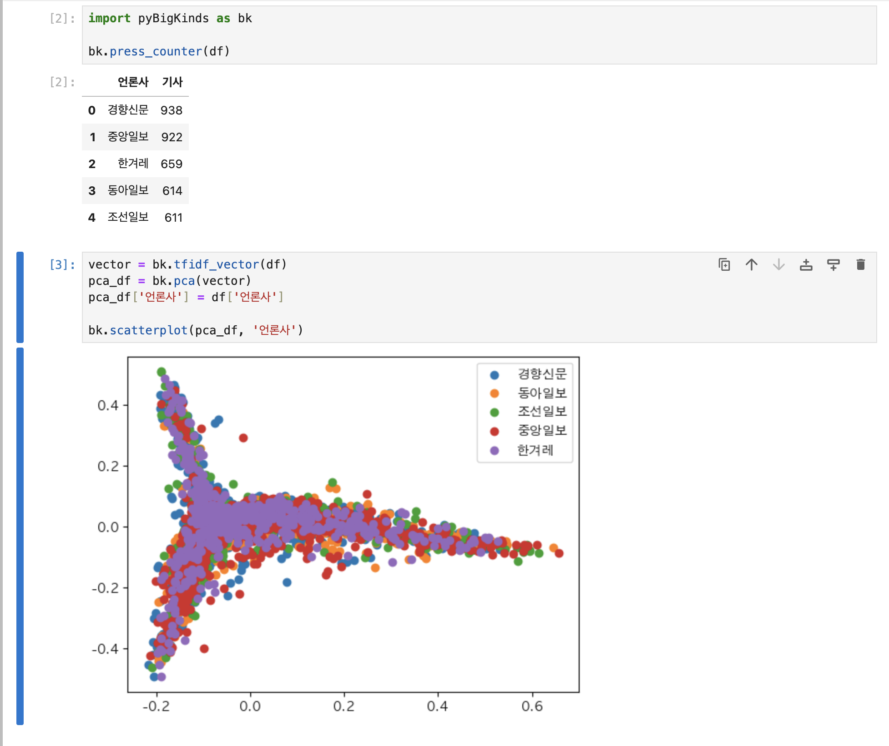
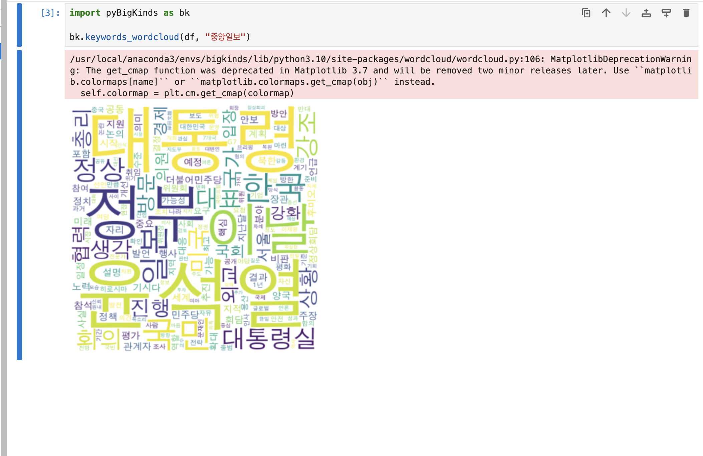

# pyBigKinds

pyBigKinds는 한국 언론의 빅데이터 저장소인 BigKinds에서 추출한 데이터를 **코드 없이(No-Code) 웹 앱으로**, 또는 low-code Python 함수로 분석할 수 있게 만든 툴입니다.

## Requirements

- Python >= 3.10
- 한글 폰트: Windows(맑은 고딕)와 macOS(AppleGothic)는 기본 폰트를 사용합니다.
  Linux에서는 `NanumGothic`(예: `sudo apt-get install fonts-nanum`) 등 한글 폰트를
  설치해야 워드클라우드와 그래프의 한글이 정상 출력됩니다.

## Installation

- macOS

  ```bash
  python3 -m pip install pyBigKinds
  ```

- Windows, linux

  ```bash
  python -m pip install pyBigKinds
  ```

## No-Code 앱 (v2.0+)

```bash
python -m pip install "pyBigKinds[app]"
pybigkinds app
```

브라우저가 열리면 BigKinds에서 내려받은 xlsx를 업로드하세요.

- BigKinds는 한 번에 20,000건까지만 내보내므로, 기간을 나눠 받은 **여러 파일을 한꺼번에 올리면** 하나로 합쳐집니다. 파일 사이에 겹친 기사는 자동으로 제거됩니다.
- 개요(언론사별 기사 수·기간), 키워드 빈도·워드클라우드, TF-IDF, 군집·차원축소, LDA·연관규칙 탭을 제공합니다.
- 모든 표는 CSV, 그림은 PNG로 내려받을 수 있습니다.

## Extras

| 설치 | 포함 |
|---|---|
| `pip install pyBigKinds` | 전처리·빈도·TF-IDF·군집·차원축소·시각화 |
| `pip install "pyBigKinds[ml]"` | + `lda`, `association` (tomotopy, mlxtend) |
| `pip install "pyBigKinds[app]"` | + No-Code 웹 앱 (streamlit) |
| `pip install "pyBigKinds[all]"` | 전부 |

> **v2.0 변경:** `lda()`·`association()`을 쓰려면 `[ml]` extra를 설치해야 합니다. 그 외 v1 코드는 수정 없이 동작합니다.

## Usage (Python)

```python
import pyBigKinds as bk

# 여러 파일 병합 + 중복 제거
df = bk.read_bigkinds(["2023_01-06.xlsx", "2023_07-12.xlsx"])
```

```python
import pyBigKinds as bk

bk.press_counter(df)
```



```python
import pyBigKinds as bk

bk.keywords_wordcloud(df, "중앙일보")

# show=False이면 그림을 띄우지 않고 matplotlib Figure를 반환합니다
fig = bk.top_words(df, "중앙일보", show=False)
fig.savefig("top_words.png")
```




## License

[MIT](https://choosealicense.com/licenses/mit/)

## you have some issue?

사용 중 문제 발생 시, 해당 Repo issue에 등록해주세요.
